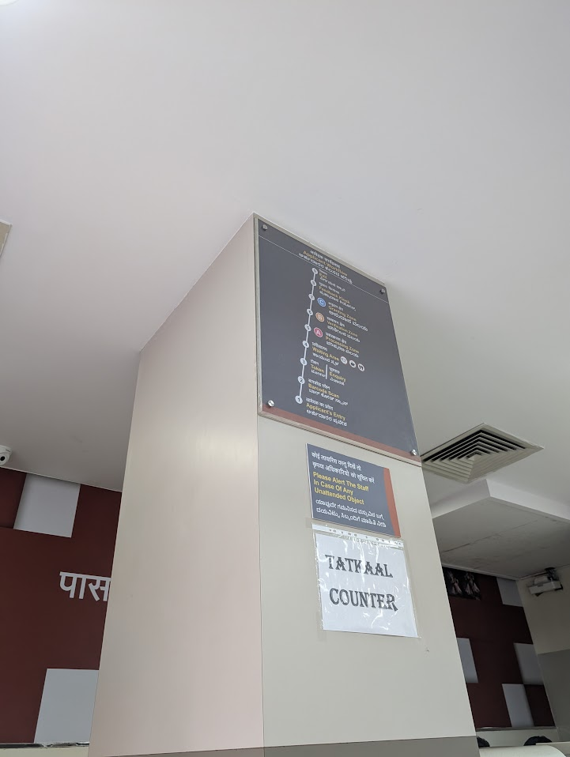

A renewal at the Passport Seva Kendra, a waiting room, and a queue system that calls a number only once someone other than its holder has looked at it.

## The waiting room

The Passport Seva Kendra changed its queue system in the spring of 2041 and gave no reason. A renewal apparently has three places to go. At the first, a camera photographs you and a person checks your documents. At the second, another person checks the same documents and asks for your date of birth and a few other things. I had given the date so many times by then that it had stopped sounding like information about me and started sounding like something I was reading out under duress. A renewal is lighter than a first application, which I had always taken as a courtesy, though it probably means the office trusts its own records over me. The booklet itself was retired years ago, and what you renew now is the office's standing belief that you are who it last decided you were. The office has never been wrong about this, having arranged for nobody to be in a position to check. Between the second place and the third there is a waiting room, and I spent two hours in it.

The old system called tokens in order. The new one, according to a laminated A4 sheet taped under the screen, "holds each token in an unresolved state until it is observed by a person other than its holder," and below that, in smaller type, advises applicants to remain visible. It also warns that cells left unobserved for too long will fade. Clearly, nothing made sense to me, akin to any experience I have at the NGMA when the Graeber and Wengrow installation is up. I sat down in one of the steel chairs, which are bolted together in threes like the ones at airports, so I had a stranger on either side of me before I had decided anything.

Everyone has a token with a letter in front of it. Mine was N817. N is for Normal, as opposed to Tatkal, which means at once and costs extra, and a good many people in the room had paid for it. Normal is a generous word for a category defined by not having paid. Many of the Tatkal people were parents with children, hurrying between the tables, out of breath, carrying more paper than they had hands for and forever leaving it somewhere and going back. I said on the phone that I should get fit before my next renewal, because by then I would probably be one of them.

{#fig-counter}

The screen is a grid of cells, one for each token in the room. Most are green. Some of the greens blink and some do not, a few are purple, and now and then one turns red. None of it is explained. The palette had plainly been chosen in a workshop, by people who were never asked what the colours were for. I spent a long while on them anyway. Purple, I decided, meant a new arrival, and red the last call, and green everything else, which covered most of the screen. That held until a new arrival came up green. The colours take up nearly all of the display and tell you very little. What matters is a few small digits somewhere inside the green, and the whole room was hunting for them.

Under the sheet's rule, a number is called only after someone other than its holder has looked at its cell. Then a voice reads it out, in English for the numbers and a little Hindi for everything around them, and the holder is meant to stand. The voice is synthetic, trained, according to the sheet, on a retired counter officer. It has kept her sigh. The rest of her had presumably been deemed non-essential. Most people missed theirs. A number would be read and nobody would move, so it was read again, and a third time, and I heard some called five times.

The televisions in the other waiting rooms ran a little behind, so you might be watching a number that had already been called. Police verification, I had learned, differs from state to state in what is asked, when it is asked and who does the asking. The idea is the same everywhere, that someone has to look at you before you can be believed, and each state has settled on a different someone. Gully cricket has fewer local rules.

So people looked, though not at their own tokens, which does nothing, or at the screen as a whole, which does very little. They read one another's slips sideways, the way you read a newspaper over a stranger's shoulder. Underneath the speaker, children and adults alike kept saying "pleaaase", drawn out, each of them asking for something different, and the room smelled faintly of food from the cafe, nothing in particular. A whole room facing one screen is the nearest thing to a congregation of a cult I have seen in a government building.

Two seats down was a man with an envelope. He had been writing numbers on the back of it for as long as I had been there, and I took him for a pattern-hunter until I saw him reading everyone's token in turn, row by row. He was easily the most generous person in the building, and he believed he was doing a sum.

The person next to me held N810. I know because I read it, and it is hard not to. It was an intimacy neither of us had asked for, and it lasted until I was called.

N944 had gone ahead of me earlier, and I had taken it personally.

At some point the man with the envelope glanced across my knee and stopped, the way people stop on a number they recognise, and the voice read out N817. "That's you," he said, which saved the voice a second try.

My head went first, and it was only arithmetic: N944 had passed me, and now I was passing 810. Wow, I thought. My heart came second and was less proud of it, a small bright flush with something heavier close behind. My tongue had the shortest turn. It began to arrange the word sorry, and then the words go ahead, and then it stopped, because 810 had not asked and I did not want to be looked at. N793 was also still waiting.

On the screen, the cells for N810 and N793 had begun to fade. I did nothing. I let out a sigh of relief and stood up.
